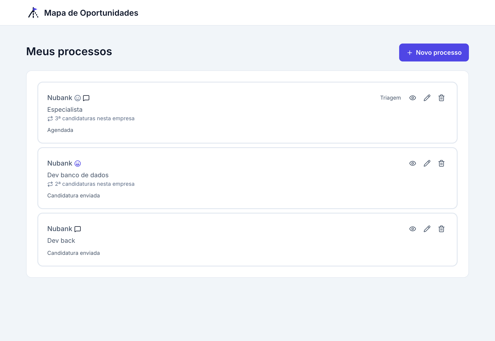
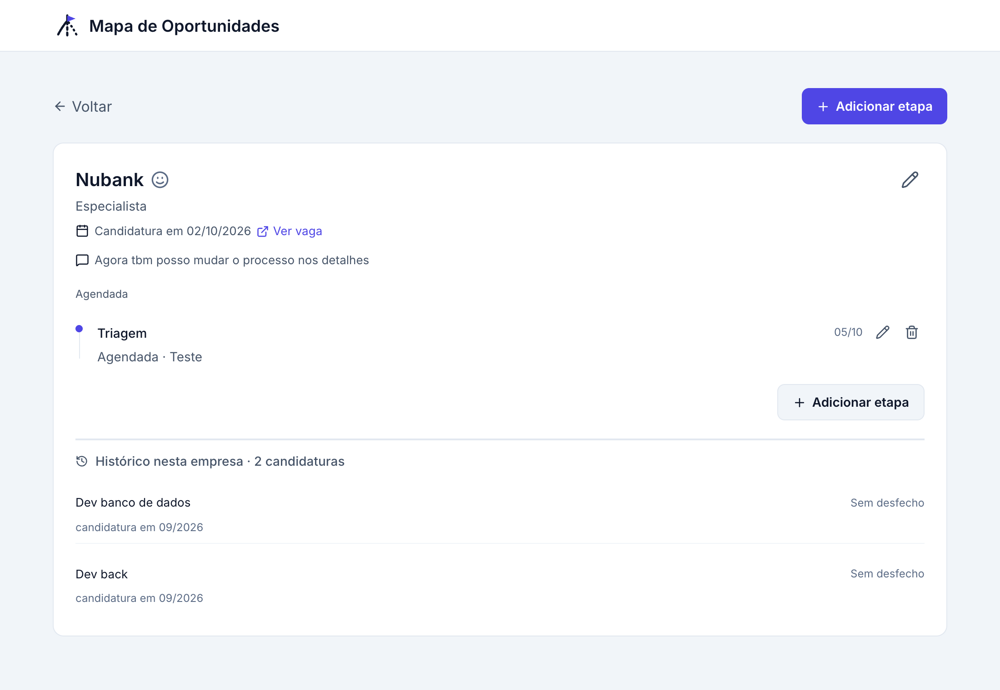
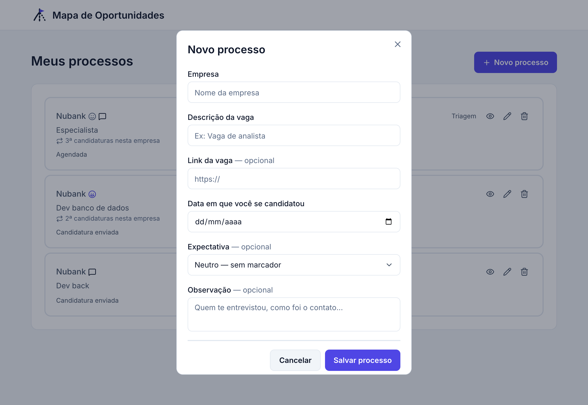
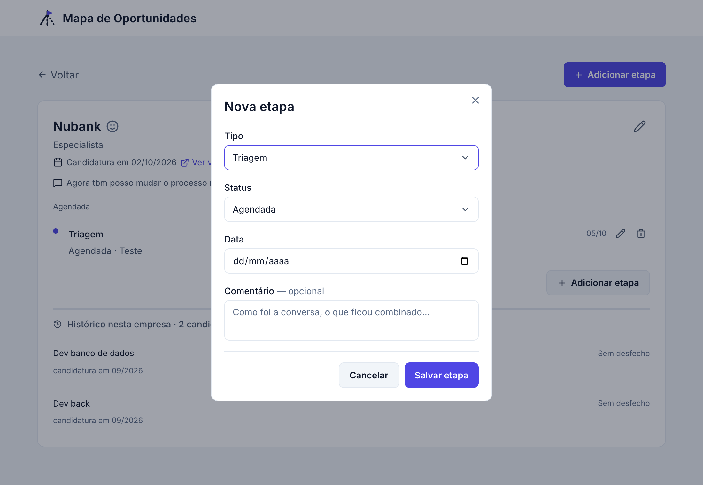
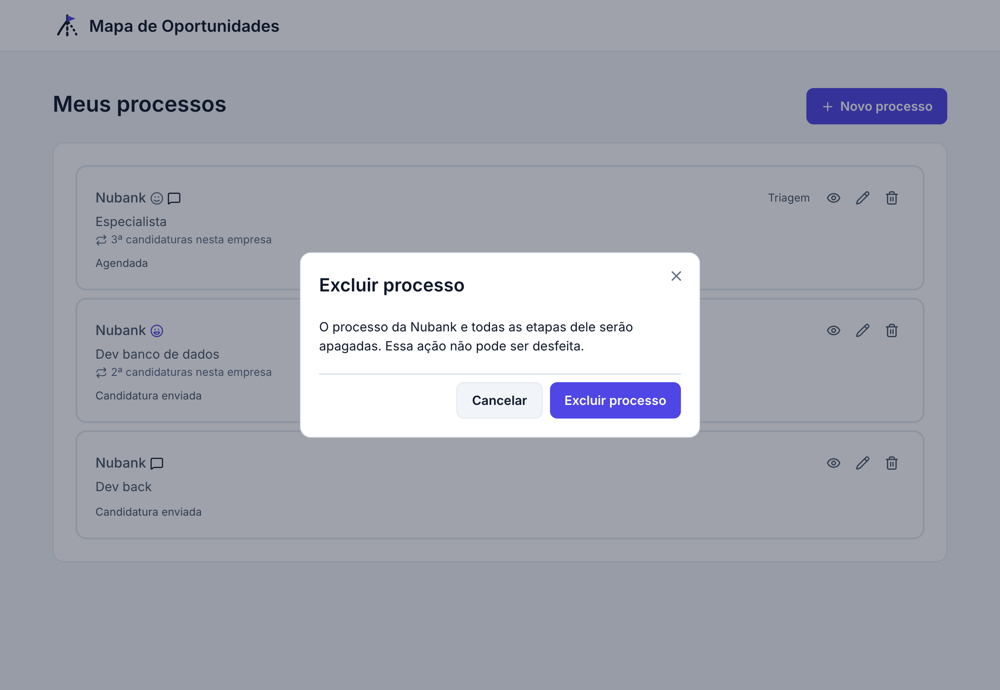
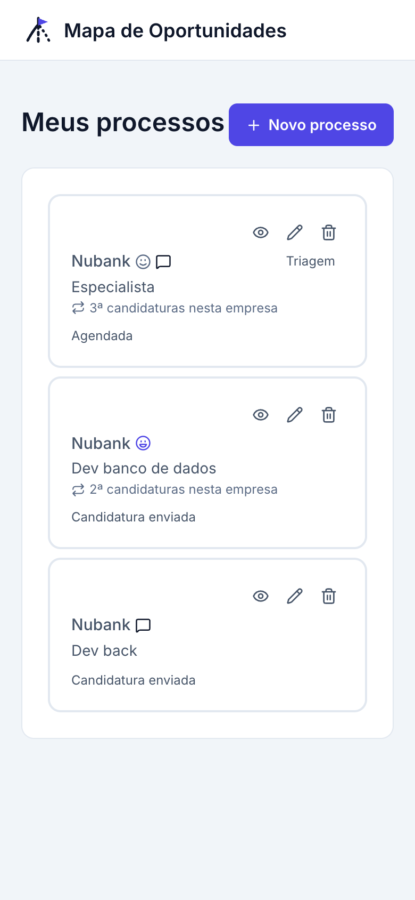

# Mapa de Oportunidades — Front-end

Interface do Mapa de Oportunidades, um app para acompanhar processos seletivos: empresa, vaga, expectativa e a linha do tempo de etapas de cada candidatura.

Este projeto consome a API do back-end (`../back`), que precisa estar rodando para a lista e o detalhe carregarem.

## Funcionalidades

- Lista de processos com badge de status calculado pelo back, tag de reaplicação ("2ª candidatura nesta empresa") e tipo da etapa atual
- Criar, editar e excluir processo, com confirmação antes de excluir
- Tela de detalhe com dados do processo, link da vaga, timeline de etapas e histórico de candidaturas anteriores na mesma empresa
- Criar, editar e excluir etapa (Triagem, Técnica, Cultural e Proposta), com campos que mudam conforme o tipo
- Validação dos formulários antes do envio, estados de carregamento e de lista vazia

## Telas

Material do curso, com o passo a passo e o Design System: [Mapa de Oportunidades — Comece aqui](https://claude.ai/code/artifact/108c2dc7-42d4-436e-b832-88130d73e523).

**Lista de processos**



**Detalhe do processo, com timeline de etapas e histórico da empresa**



| Novo processo | Nova etapa |
|---|---|
|  |  |

| Confirmar exclusão | Celular |
|---|---|
|  |  |

## Stack

| Para quê | O que |
|---|---|
| Base | React 19, Vite, TypeScript |
| Estilo | Tailwind CSS v4, `tailwind-variants`, `tailwind-merge` |
| Rotas | `react-router` 8 |
| Dados do servidor | TanStack Query |
| Formulários | React Hook Form, Zod |
| Componentes base | Radix UI (Dialog, Select, Slot), ícones do `lucide-react` |
| Lint e formatação | Biome |

## Pré-requisitos

- Node.js 24
- pnpm
- O back-end rodando em `http://localhost:3333` (pasta `../back`, `pnpm dev`)

## Como rodar

```bash
pnpm install
cp .env.example .env
pnpm dev
```

Abra `http://localhost:5173`.

## Variáveis de ambiente

| Variável | Para quê | Exemplo |
|---|---|---|
| `VITE_BACKEND_URL` | Endereço da API. O prefixo `VITE_` é obrigatório: sem ele o valor não chega ao navegador | `http://localhost:3333` |

## Scripts

| Comando | O que faz |
|---|---|
| `pnpm dev` | Servidor de desenvolvimento com recarga automática |
| `pnpm build` | Confere os tipos e gera o build de produção em `dist/` |
| `pnpm preview` | Serve o build de produção localmente |
| `pnpm lint` | Confere o código com o Biome |
| `pnpm format` | Corrige formatação e ordem dos imports |

## Rotas

| Rota | Tela |
|---|---|
| `/` | Meus processos |
| `/processos/:id` | Detalhe do processo: etapas e histórico |

## Estrutura

```
src/
  components/     telas e peças da interface (card, formulários, timeline, modais)
    ui/           componentes base sem regra de negócio (button, input, select, modal)
  hooks/process/  chamadas à API com TanStack Query (processos e etapas)
  lib/            api, formatação de data e moeda, mapas de ícone e de tipos de etapa
  pages/          Home e DetailsSteps
  types/          formato dos dados que vão e voltam da API
  index.css       tokens do Design System (cores, raios) e fontes
```

Imports usam o alias `@/`, que aponta para `src/`.

## Como o front fala com o back

| Ação | Hook | Rota da API |
|---|---|---|
| Listar processos | `use-processes` | `GET /processes` |
| Ver um processo | `use-find-process` | `GET /processes/:id` |
| Histórico da empresa | `use-process-history` | `GET /processes/:id/history` |
| Criar, editar, excluir processo | `use-create-process`, `use-update-process`, `use-delete-process` | `POST /processes`, `PUT /processes/:id`, `DELETE /processes/:id` |
| Listar etapas | `use-stages` | `GET /processes/:processId/stages` |
| Criar etapa | `use-create-stage` | `POST /processes/:processId/stages` |
| Editar, excluir etapa | `use-update-stage`, `use-delete-stage` | `PUT /stages/:id`, `DELETE /stages/:id` |

Depois de criar, editar ou excluir, os hooks invalidam as consultas afetadas. Mudanças em etapas invalidam também `["processes"]`, porque o badge e o tipo da etapa no card dependem da etapa atual.

## Design System

As cores, os raios e a tipografia vêm do Design System do Mapa de Oportunidades e estão em `src/index.css` como variáveis CSS, mapeadas para classes do Tailwind (`bg-accent`, `text-ink-muted`, `rounded-card`). O app usa só o tema claro. Espaçamento usa a escala padrão do Tailwind, sem token próprio.

A regra de cada badge (urgente, atenção, info, conquista, encerrado e neutro) fica no back, em `back/src/lib/process-badge.ts`. O front só desenha o que recebe.

---

Feito com carinho por Kayza ❤️
